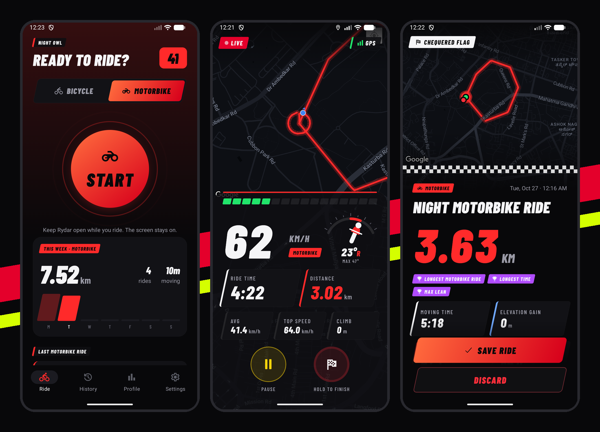
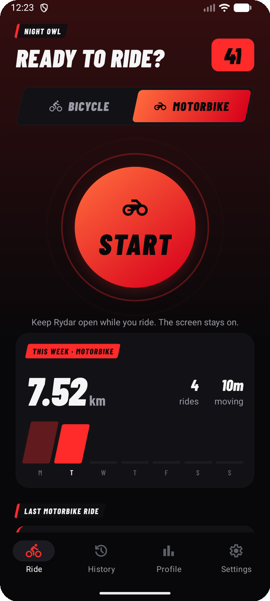
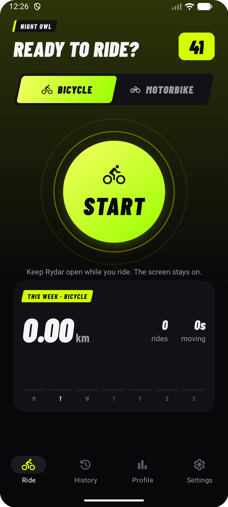
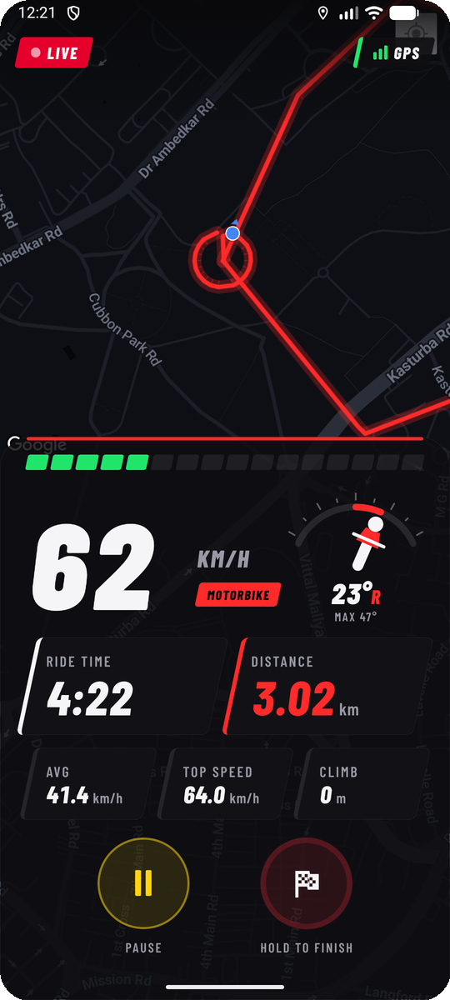
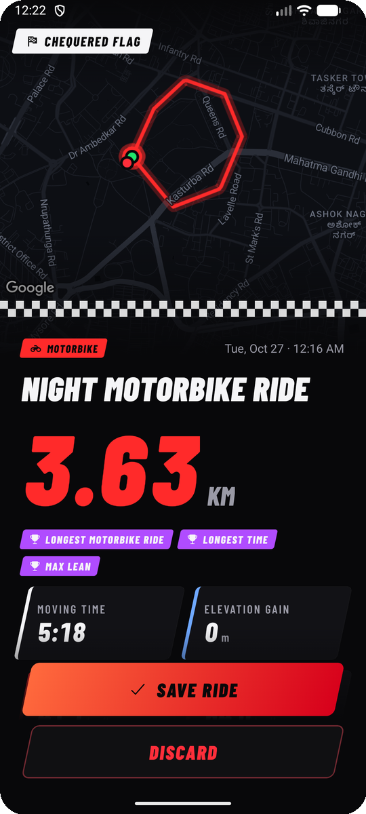
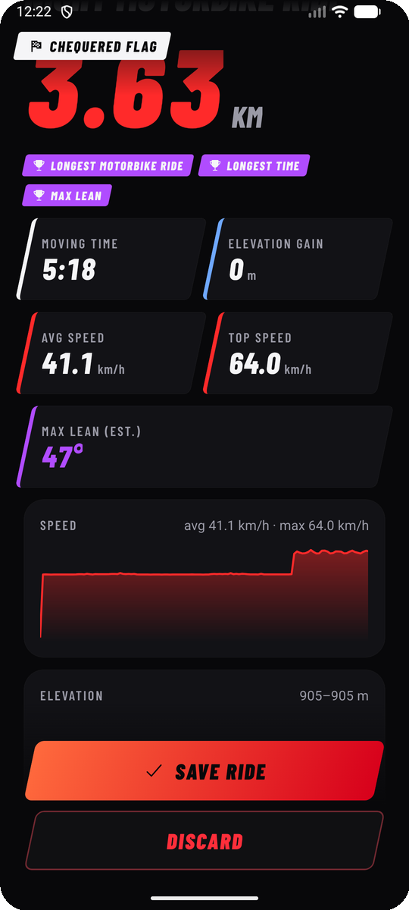
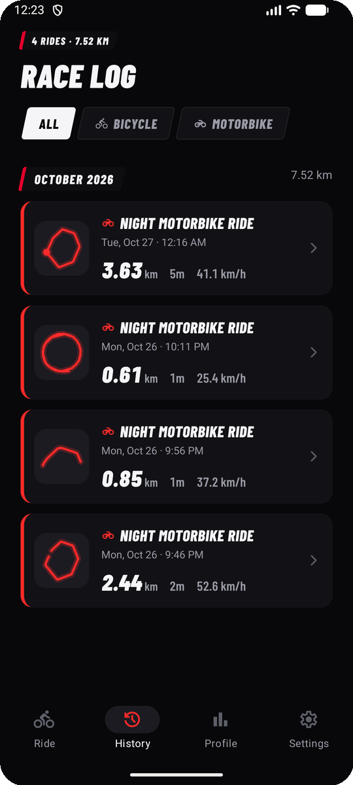
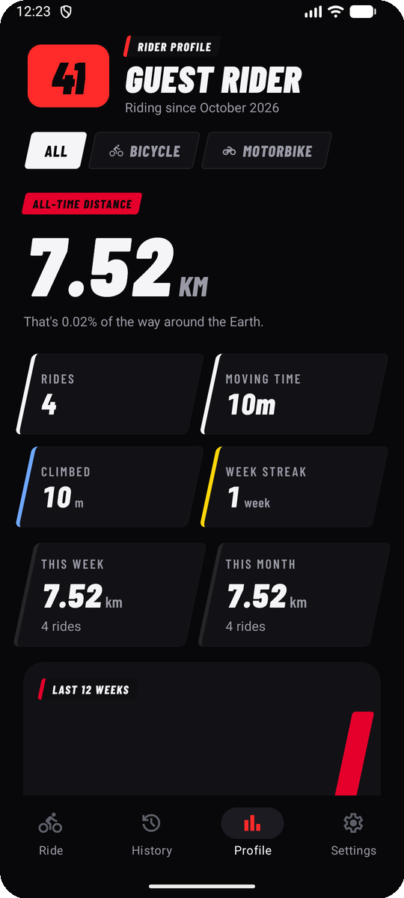
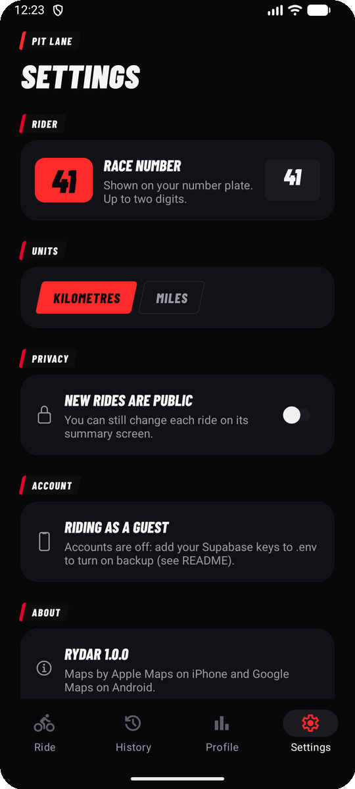

# Rydar: a ride tracker for bicycles and motorbikes

<p align="center"></p>

A Strava-style ride tracker for one rider, built with Expo (React Native) and TypeScript. It records live GPS rides for a **bicycle** or a **motorbike**: it draws the route on a dark map and shows a race-dash HUD with speed, lean angle, distance, time, average and max speed, and climb. Rides go to history, profile stats and personal records. Rides are saved on the phone first and back up to your own free Supabase project when you sign in.

Everything in the first version is free. See [What costs money](#what-is-free-and-what-costs-money).

## Screenshots

<table>
  <tr>
    <td align="center"><br /><sub>Home: motorbike</sub></td>
    <td align="center"><br /><sub>Home: bicycle</sub></td>
    <td align="center"><br /><sub>Live ride and lean gauge</sub></td>
    <td align="center"><br /><sub>Chequered flag</sub></td>
  </tr>
  <tr>
    <td align="center"><br /><sub>Stats, records, charts</sub></td>
    <td align="center"><br /><sub>Race log</sub></td>
    <td align="center"><br /><sub>Rider profile</sub></td>
    <td align="center"><br /><sub>Pit lane settings</sub></td>
  </tr>
</table>

Taken on the Android emulator with a simulated ride, so the map is Google Maps. On an iPhone it is Apple Maps.

## Features

- **Race-broadcast look:** black-italic numbers, slanted race tags and timing-tower tiles, a chequered finish line, and timing-screen colours (purple = a record, yellow = paused, red = live).
- **Start lights:** five red lights come on one by one, then go out and the ride starts. Tap to skip; with Reduce Motion on it starts straight away.
- **Live ride:** dark full-screen map with a neon route, a race-dash HUD (shift-light bar, huge speed readout, ride time, distance, avg, top speed, climb), Pause/Resume, and **press-and-hold to finish** (no accidental stops from a bump or a glove). Top speed turns purple the moment it beats your record for that activity. The screen stays awake.
- **Lean angle:** an on-board style graphic of the rider tilting over an arc, with the live angle (L/R) and the ride's max. Max lean is saved with the ride and kept as a personal record per activity.
- **Bicycle / motorbike:** each ride stores its activity type. GPS spike filtering uses a different plausible top speed for each (100 km/h for a bicycle, 350 km/h for a motorbike). Records are always kept per activity, so a motorbike top speed never shows up as a cycling record. The app's accent colour follows the activity: fluo yellow for bicycle, MotoGP red for motorbike.
- **Ride summary:** route map with start and finish markers, distance, moving time, avg and max speed, elevation gain, speed and elevation charts, record badges, public/private toggle, Save or Discard.
- **History:** rides grouped by month, each with a small drawing of its route, filterable by activity.
- **Profile:** all-time totals, this week and this month compared with the last, the last 12 weeks as bars, week streak, and personal records per activity.
- **Settings:** race number for your number plate, km or miles, default ride visibility, account, sync status with a "Sync now" button.
- **Offline first:** every GPS point is written to SQLite as it arrives. If the app is killed mid-ride, Home offers to **Resume, Finish or Discard** it. Rides wait in a queue and upload when there is a connection.
- **Accounts:** email/password through Supabase Auth, or **ride as a guest** with no account and no backend at all.

## Stack

| Part | Choice | Why |
| --- | --- | --- |
| App | Expo SDK 58, React Native 0.88, TypeScript, Expo Router (native tabs) | Runs in Expo Go on a real phone with no build step |
| GPS | `expo-location` (foreground) | Included in Expo Go |
| Maps | `react-native-maps` | Included in Expo Go. Apple Maps on iOS needs no key and costs nothing |
| Local storage | `expo-sqlite` (rides, points, settings, auth session) | One package covers all three |
| Backend | Supabase free tier (Auth + Postgres with row level security) | Free, no server to run |
| UI | Reanimated, react-native-svg, expo-linear-gradient, expo-glass-effect, Barlow Condensed | All included in Expo Go |

## Project layout

```
app/                     screens (Expo Router: each file is a route)
  _layout.tsx            providers, fonts, login guard
  (auth)/login.tsx       sign in / ride as guest
  (auth)/signup.tsx
  (tabs)/_layout.tsx     native tab bar: Ride, History, Profile, Settings
  (tabs)/index.tsx       home dashboard + START
  (tabs)/history.tsx
  (tabs)/profile.tsx
  (tabs)/settings.tsx
  ride/track.tsx         live ride
  ride/summary/[id].tsx  after a ride: save or discard
  ride/[id].tsx          ride details
components/              StartButton, StartLights, RevBar, RaceTag, Tile, NumberPlate, HoldButton, RouteMap, RideView, …
hooks/                   useAuth, useSettings, useRides, useRideTracker
services/tracker.ts      pure ride state: GPS filtering, distance, speeds, climb, pauses (unit tested)
services/rides.ts        SQLite reads/writes, upload queue, pull from Supabase
lib/                     db (SQLite schema), supabase client, theme, activity config
utils/                   geo (haversine, climb), format (units, time), polyline (encode/decode), stats
types/                   shared TypeScript types
supabase/schema.sql      tables, row level security, sign-up trigger
__tests__/               Jest tests for the tracker and utils
docs/screenshots/        README images
```

There is no separate `screens/` folder. With Expo Router, each file in `app/` is the screen, so a `screens/` folder would only hold one-line re-exports.

## Setup

You need Node **22.13 or newer** (Expo SDK 58 requires it). With nvm: `nvm install 22 && nvm use` (the repo has an `.nvmrc`).

```bash
npm install
```

### Option A: no backend (guest mode)

Skip the env file. The app starts, the login screen says accounts are off, and **Ride as guest** keeps everything on the phone.

### Option B: with Supabase (free)

1. Create a project at [supabase.com](https://supabase.com) (free plan).
2. In the dashboard, open **SQL Editor**, paste the contents of [`supabase/schema.sql`](supabase/schema.sql), and click Run.
3. **Project Settings → API**: copy the Project URL and the **publishable** key (older projects call it the `anon` key).
4. Create `.env` in the project root:

   ```bash
   cp .env.example .env
   ```

   ```
   EXPO_PUBLIC_SUPABASE_URL=https://your-project-ref.supabase.co
   EXPO_PUBLIC_SUPABASE_PUBLISHABLE_KEY=sb_publishable_...
   ```

   `EXPO_PUBLIC_` values are compiled into the app and are meant to be public. Row level security in `schema.sql` is what keeps each rider's data private. **Never** put the `service_role`/secret key in the app or in `.env`. `.env` is git-ignored.
5. Optional, for a single-user setup: **Authentication → Sign In / Providers → Email**, turn off **Confirm email**. You can then sign in right after signing up, and you skip the free plan's low hourly email limit.

Restart `npx expo start` after changing `.env`.

## Run it

```bash
npx expo start
```

- **Real phone (iPhone or Android):** install **Expo Go** from the App Store or Play Store. Put the phone on the same Wi-Fi as your computer and scan the QR code: on iPhone with the Camera app, on Android with Expo Go. If your network blocks this, run `npx expo start --tunnel`.
- **Android emulator:** press `a` in the terminal.
- **iOS Simulator** (needs Xcode on a Mac): press `i`. To fake a ride, use Simulator → Features → Location → *City Bicycle Ride* or *Freeway Drive*.

Expo Go must match the project's SDK (58). The App Store version of Expo Go always supports the latest SDK.

### Tests and checks

```bash
npm test            # tracker + utils unit tests
npm run typecheck
npx expo-doctor
```

## Things to know (limits of the free route)

- **Tracking runs while the app is on screen.** Expo Go cannot track in the background on iOS, so Rydar keeps the screen awake during a ride. Mount the phone or keep the app open. If you switch apps, recording pauses until you come back, and the gap is joined with a straight line. Background tracking needs a **development build** (below), the `isIosBackgroundLocationEnabled` option of the `expo-location` plugin, and `Location.startLocationUpdatesAsync` with a TaskManager task.
- **Lean angle is an estimate.** A phone's tilt sensor cannot measure lean: in a balanced turn the bike and rider lean together and the sensor reads "upright". Rydar uses the physics of a steady turn instead, tan(lean) = speed × turn rate ÷ g, with the turn rate taken from how fast the GPS heading changes. It works however the phone is mounted, needs 15 km/h or more, is smoothed, and is capped at 65°. Expect it to be within a few degrees in smooth corners and less reliable in tight, slow ones.
- **GPS altitude is rough.** Elevation gain counts a climb only after a 3 m rise, so the wobble does not add up into fake metres.
- **Android maps:** Expo Go includes a Google Maps key. A standalone Android build needs your own key (`react-native-maps` plugin, `androidGoogleMapsApiKey`). The Maps SDK for Android has no usage charge, but Google Cloud asks for a billing account to create the key. If you want no Google account at all, switch to MapLibre in a development build.
- **Supabase free projects pause after about a week without activity.** Riding still works because data is local first. Un-pause the project in the dashboard, and the queue uploads on the next app start.

## iPhone: from free testing to the App Store

**1. Free, today: Expo Go.** Everything in this README runs inside Expo Go on your own iPhone. You need no Apple account, no Mac build and no fee.

**2. Free, on a Mac: development build with a free Apple ID.** This adds background tracking and other native code. Install Xcode, then run:

```bash
npx expo run:ios --device
```

Sign in to Xcode with your normal Apple ID (Personal Team). The app installs on your iPhone, but a free-team build **expires after 7 days** and you rebuild it. The free team allows at most 3 apps. No TestFlight.

**3. Paid: TestFlight and the App Store.** The Apple Developer Program costs **US$99 per year**, and you need it for TestFlight and App Store releases. Then run:

```bash
npm install -g eas-cli        # or use npx eas-cli@latest
eas login                     # free Expo account
eas build:configure
eas build --platform ios      # EAS asks for your Apple Developer login and handles certificates
eas submit --platform ios     # uploads to App Store Connect → TestFlight
```

Change `ios.bundleIdentifier` / `android.package` in `app.json` to your own before the first build. The free EAS plan includes a limited number of cloud builds each month. `eas build --local` builds on your own Mac at no cost.

## What is free and what costs money

| Item | Cost |
| --- | --- |
| Expo, Expo Go, Expo Router, all libraries used | Free |
| Running on your iPhone or Android phone through Expo Go | Free |
| Supabase (Auth, Postgres, row level security) | Free plan: 2 projects, 500 MB database; pauses after inactivity |
| Apple Maps on iOS | Free, no key |
| Google Maps in Expo Go on Android | Free (Expo's key) |
| Your own Google Maps key for a standalone Android build | No usage charge for the mobile SDK, but needs a Google Cloud billing account |
| Development build on your own iPhone with a free Apple ID | Free (Xcode on a Mac; rebuild every 7 days) |
| EAS Build cloud builds | Free plan has a monthly build limit; `--local` builds are free |
| **Apple Developer Program** (TestFlight, App Store) | **US$99 / year** |
| **Google Play developer account** | **US$25 one time** |
| Supabase Pro (no pausing, more space) | US$25 / month, only if you outgrow the free plan |

## Running it on your iPhone without paying

1. Install **Expo Go** from the App Store.
2. On your Mac: `nvm use && npm install && npx expo start`.
3. Put the phone on the same Wi-Fi and scan the QR code with the Camera app.
4. Choose **Ride as guest** (or sign in once `.env` has your Supabase keys), pick Bicycle or Motorbike, and press START.
5. Allow location "While Using the App", mount the phone, and ride with Rydar on screen.

That costs nothing. You only pay once you want TestFlight or the App Store (Apple's US$99 per year).
